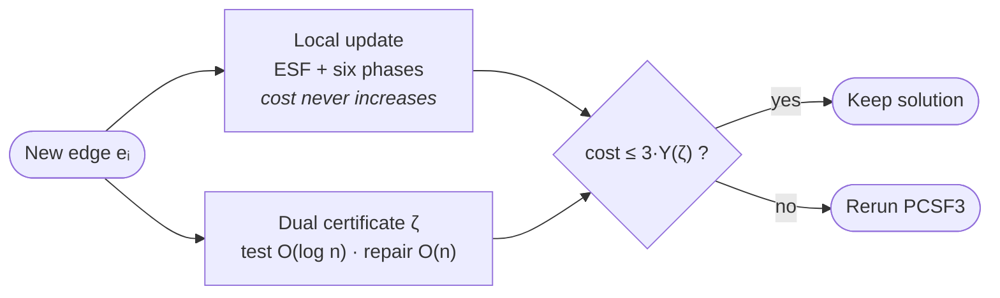

# Incremental Prize-Collecting Steiner Forest
### A 3-Approximation with Local Updates — M.Tech Thesis, Phase I

**Atharva Phadtare** (Roll No. 254101010)  
Supervisor: **Prof. Sushanta Karmakar**  
Department of Computer Science and Engineering, IIT Guwahati — November 2026

> **≤ 3·OPT after every insertion** · **O(log n) test, O(n) repair** · **rebuilds after ≤ 1.6 % of insertions**

---

## Contents of this folder

```
MTP_PHASE_1/
├── Report/
│   └── IITG_Thesis.pdf                       # full thesis (63 pages)
├── Presentation notes/
│   └── Thesis Atharva- 254101010.pptx        # Phase I evaluation deck (22 slides)
└── README.md
```

---

## The problem

You run a network. Some pairs of places need to be connected, but not at any price: each **demand pair** carries a **penalty**. For every pair you either *buy edges* to connect it, or *leave it apart and pay its penalty*.

$$\text{cost}(F, Q) \;=\; \underbrace{w(F)}_{\text{edges bought}} \;+\; \underbrace{\textstyle\sum_{p \in Q} \pi_p}_{\text{penalties paid}}$$

This is the **Prize-Collecting Steiner Forest (PCSF)** problem. It is NP-hard; the best known static factor is 2 (Ahmadi et al.).

**The twist studied here:** the network keeps gaining links. Edges arrive one at a time, while vertices, demand pairs and penalties stay fixed. After every insertion a good solution must be available — **without solving from scratch each time**.

## Why it is hard

A single new edge can collapse the optimum. If a pair is joined by a path of *k+1* unit edges and an edge of weight 2 is inserted between its endpoints, OPT falls from *k+1* to 2 — the old solution is suddenly *(k+1)/2* times worse than optimal.

So a guarantee measured against the *old* optimum is worthless. We need a **lower bound on the new optimum** after every insertion, without recomputing.

---

## The approach: two structures side by side



One structure **proposes** cheaper solutions; the other **proves** how good the current one is. The factor-3 guarantee never depends on the first.

**Design principles**

- **D1 — The ESF is a helper, not the output.** The solution may use any edge of the graph.
- **D2 — Classify every edge; reconsider only the pairs it affects.**
- **D3 — The guarantee comes from the certificate.** Any update rule that never raises cost keeps the factor 3.

### 1 · The PCSF3 dual certificate

PCSF3 (Hajiaghayi & Jain, restated by Ahmadi et al.) is a primal–dual algorithm. Moats grow around terminals at equal speed and pay for edges; it returns both a solution and a **feasible dual of the LP relaxation**, giving a lower bound *Y(ζ) ≤ OPT* and *cost ≤ 3·Y(ζ)*.

On each insertion the stored certificate is **tested in O(log n)**. If the new edge violates it, only the moats that separate its endpoints are shrunk — a **targeted repair in O(n)**. PCSF3 is rerun only if the repaired certificate can no longer prove the factor 3.

### 2 · The Extended Steiner Forest (ESF)

An auxiliary forest built once from the initial graph, as if every reachable pair had infinite penalty:

1. **Cut packing** connects all reachable demand pairs into trees.
2. **Thresholds** — each tree *T* gets *h(T)*, its longest demand-pair path.
3. **Extension** — a multi-source Dijkstra attaches every nearby vertex within *h(T)* of its nearest tree.

Each inserted edge is then classified into one of **seven cases**:

`0 New` · `1 Join` · `2 Merge` · `3 Absorb` · `4 Park` · `5 Swap` · `6 Reject`

### 3 · The six-phase update

| Phase | What it does |
|---|---|
| 1 | **Reachability** — union–find tracks components of the graph |
| 2 | **Filing** — classify the edge into a case; update the ESF |
| 3 | **Route completion** — give newly reachable pairs a route |
| 4 | **Demand check** — find pairs whose route the edge shortens |
| 5 | **Swap & prune** — replace a heavier cycle edge; remove dead branches |
| 6 | **Connect or pay** — buy a route only if it costs no more than the penalty |

The update keeps the solution feasible and normalised, never increases its cost, and computes at most *n − 1* shortest paths over the whole insertion sequence.

---

## Contributions

1. A feasible **dual certificate** proving a factor-3 bound after every edge insertion, with recomputation only when the repaired certificate is insufficient *(Theorem 5.8)*.
2. A **worst-case construction** showing recomputation cannot always be avoided — instances that force a rerun after every second insertion while OPT stays constant *(Theorem 5.13)*.
3. The **Extended Steiner Forest** and a six-phase local update with *O(n² + n|D|)* amortised time per insertion, apart from re-filing parked edges *(Proposition 6.1)*.
4. A **reproducible benchmark** with instances up to 320 vertices.

## Key results

- **Quality:** on small instances with MILP-verified optima, the dual-based ESF variant has mean cost **1.076 · OPT** (rerunning IPCSF every time: 1.044).
- **Rebuilds:** targeted repair plus a local rule absorbs **95–99 %** of certificate violations; mean rebuild rate is **0.6–1.6 %** across tested families, versus 32–40 % when rebuilding on every violation.
- **Speed:** a full 100-insertion stream costs **1.4–3 %** of the time of recomputing after every insertion.
- **Caveat:** in the worst case a single insertion can still cost as much as a static recomputation — the contribution is the dual-based invariant and a cheap way to maintain it between rebuilds, not a faster worst-case update.

*Experiments use a Python reference implementation with exact rational arithmetic; see Chapter 7 of the report for setup, statistics and limitations.*

---

## Open problems

1. **Few rebuilds** — a sublinear rebuild bound for restricted insertion families.
2. **Local re-growth of moats** after a targeted repair, instead of a full rerun.
3. **A dual-based factor 2** — needs a stronger relaxation (the natural LP has integrality gap ≥ 9/4).
4. **Worst-case time of the ESF rule** — bounding re-filings and removing the |D| factor.
5. **Experiments at scale** — optimised data structures, real evolving networks.

---

## Report structure

| Ch. | Topic |
|---|---|
| 1 | Introduction and problem statement |
| 2 | Related work and approach |
| 3 | The Extended Steiner Forest |
| 4 | Processing a new edge (six phases) |
| 5 | Dual-based updates: the 3-approximation |
| 6 | Data structures and analysis |
| 7 | Experiments |
| 8 | Open problems and conclusion |
| A | Proofs, worked example, notation |

**Keywords:** Prize-collecting Steiner forest · Incremental algorithms · Dynamic graphs · Approximation algorithms
